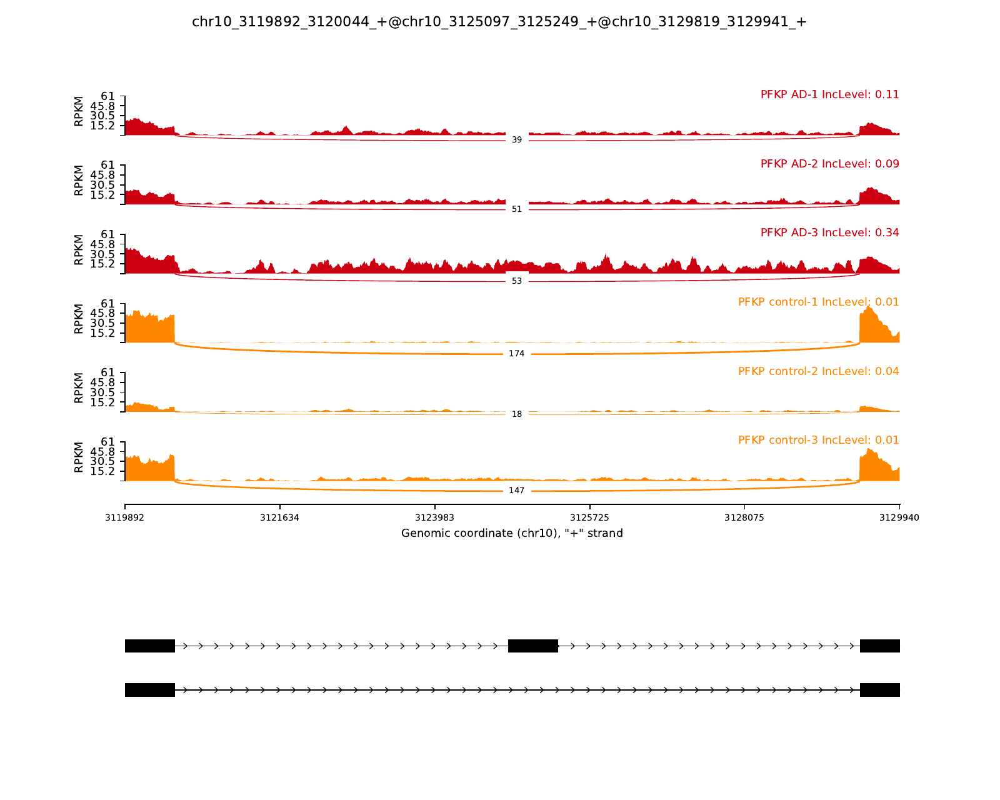
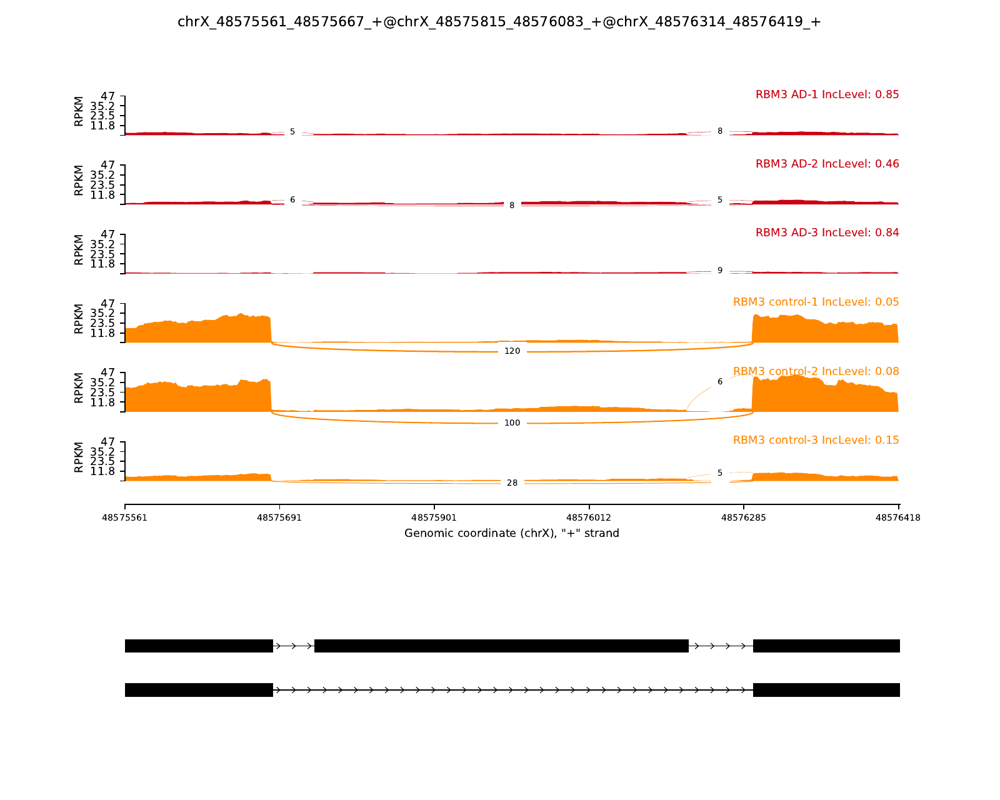
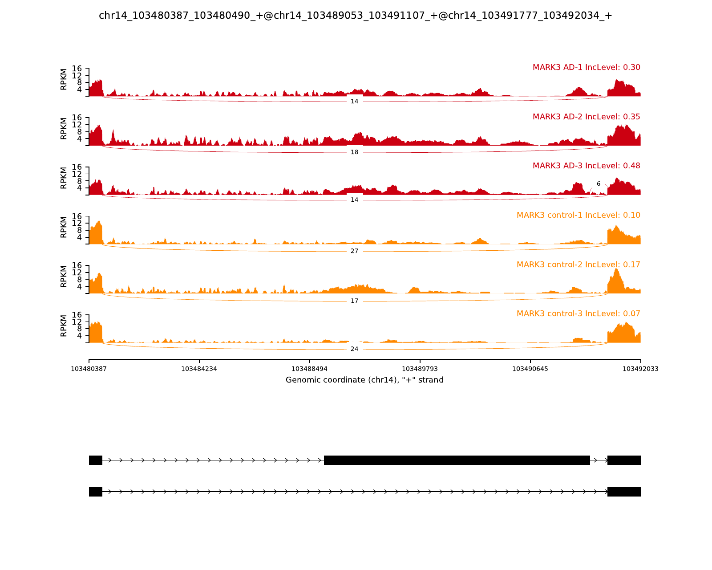

# rMATS Skipped-Exon Analysis: AD vs Control

This repository packages a reproducible rMATS skipped-exon workflow and the current lightweight results for a 3 Alzheimer disease (AD) vs 3 control RNA-seq comparison.

The original analysis was run in a local WSL-based RNA-seq project directory. Large local inputs and full intermediate outputs are represented with manifests instead of being committed to the repository.

## What Is Included

- `metadata/`: sample table and rMATS BAM group files.
- `scripts/`: stepwise scripts for checking inputs, QC, STAR alignment, rMATS, SE filtering, and selected sashimi plotting.
- `data_manifest/`: manifests describing the raw FASTQ/reference inputs and generated result files.
- `results/rmats_summary/`: compact rMATS summary tables, including high-confidence SE events.
- `results/sashimi_selected/`: selected SE event file, summary table, and selected sashimi plot PDFs.
- `docs/`: short interpretation notes and file organization.

Large files such as FASTQ, BAM, STAR index, and full reference FASTA/GTF are intentionally not copied into this GitHub-ready folder. They are recorded in `data_manifest/` instead.

## Biological Design

Comparison:

- Group 1: AD
- Group 2: control
- Samples: 3 AD vs 3 control
- Sequencing mode used for rMATS: single-end
- Read length: variable, nominal read length 75
- Library type: `fr-firststrand`
- Reference: GRCh38 primary assembly
- Annotation: GENCODE v44 primary assembly annotation

## Reproduce From Raw Data

Place or mount the raw input files so the paths in `metadata/samples.tsv` resolve under `datam/` in the parent project folder, or set `PROJECT_ROOT` explicitly.

Typical usage from this repository folder:

```bash
conda env create -f environment/conda_env_export.yml
```

```bash
export CONDA_BIN=conda
export ENV_NAME=troppo_rmats_project
export THREADS=6

bash scripts/00_check_inputs.sh
bash scripts/01_run_qc.sh
bash scripts/02_prepare_reference.sh
bash scripts/03_build_star_index.sh
bash scripts/04_align_star.sh
bash scripts/05_run_rmats.sh
$CONDA_BIN run -n $ENV_NAME python scripts/06_summarize_rmats_results.py
$CONDA_BIN run -n $ENV_NAME python scripts/07_extract_high_confidence_se.py
$CONDA_BIN run -n $ENV_NAME python scripts/08_select_sashimi_events.py
bash scripts/09_run_selected_sashimi.sh
```

Or run the whole workflow:

```bash
bash scripts/run_all.sh
```

## Current Main Findings

The compact high-confidence SE filter used:

- `FDR < 0.05`
- `PValue < 0.001`
- `abs(delta PSI) >= 0.10`
- total junction count `>= 50`

Current high-confidence SE result:

- 785 SE events
- 669 SE genes

Selected sashimi examples:

| Gene | Direction | FDR | Delta PSI AD-control | Note |
|---|---:|---:|---:|---|
| PFKP | AD higher inclusion | 2.36e-12 | +0.162 | Metabolism/GEM-relevant glycolysis gene |
| RBM3 | AD higher inclusion | 2.34e-08 | +0.622 | Neurodegeneration/synaptic-protection literature link |
| MARK3 | AD higher inclusion | 3.74e-07 | +0.266 | Tau/microtubule biology link; high read support |
| AMPH | AD higher inclusion | 1.81e-07 | +0.202 | Synaptic vesicle/endocytosis and tau-related literature link |
| PBRM1 | Control higher inclusion | 1.91e-08 | -0.636 | Exploratory; lower total count |

See:

- `results/rmats_summary/SE_high_confidence_lowFDR_lowP_highCount.tsv`
- `results/rmats_summary/SE_high_confidence_genes_best_event.tsv`
- `results/sashimi_selected/selected_SE_events_summary.tsv`

## Selected Outputs







- [PFKP sashimi plot](results/sashimi_selected/1_PFKP_chr10_3119892_3120044_+@chr10_3125097_3125249_+@chr10_3129819_3129941_+.pdf)
- [RBM3 sashimi plot](results/sashimi_selected/2_RBM3_chrX_48575561_48575667_+@chrX_48575815_48576083_+@chrX_48576314_48576419_+.pdf)
- [MARK3 sashimi plot](results/sashimi_selected/3_MARK3_chr14_103480387_103480490_+@chr14_103489053_103491107_+@chr14_103491777_103492034_+.pdf)
- [High-confidence skipped-exon events](results/rmats_summary/SE_high_confidence_lowFDR_lowP_highCount.tsv)
- [Selected SE events summary](results/sashimi_selected/selected_SE_events_summary.tsv)

## Important Limits

This is a small exploratory cohort (`n=3` AD, `n=3` control). The results should be treated as candidate splicing events, not definitive disease biomarkers. Stronger interpretation requires independent cohorts, event-level validation, and isoform/protein consequence mapping.
